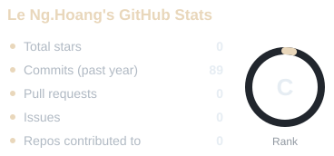

  

## About Me

- 👋 Hi, I'm Hoang, a curious human from Vietnam.
- 💻 I enjoy exploring technology and building things for fun.
- ☕ Powered by coffee, curiosity, and a little bit of code.
- 🐈 A cat lover who enjoys the little things in life.
- 🌱 Always learning, experimenting, and enjoying the journey.

## 🛠️ Tech Stack

  <!-- Ngôn ngữ lập trình và Styling -->
  
  
  
  
  
  

  <!-- Framework và Runtime -->
  
  
  
  

  <!-- Cơ sở dữ liệu -->
  
  

  <!-- Hệ điều hành -->
  
  
  

  <!-- Hạ tầng và máy chủ -->
  
  
  
  

  <!-- Công cụ phát triển -->
  
  
  

## GitHub Stats

  
  &nbsp;
  

