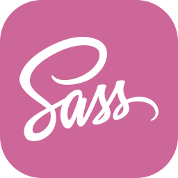
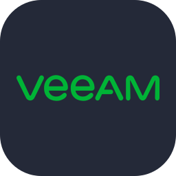
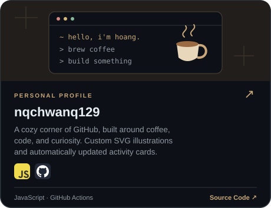
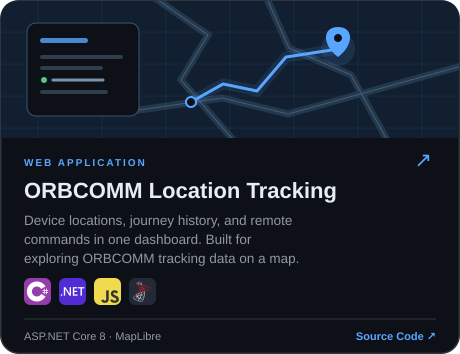
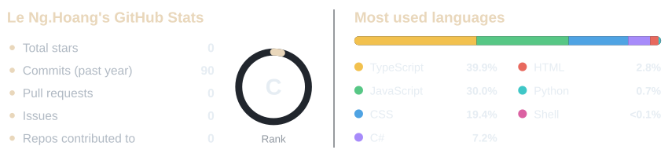

  

  
  
  
  
  
  
  

### 👋 About Me

- 👋 Hi, I'm Hoang, a curious human from Vietnam.
- 💻 I enjoy exploring technology and building things for fun.
- ☕ Powered by coffee, curiosity, and a little bit of code.
- 🐈 A cat lover who enjoys the little things in life.
- 🌱 Always learning, experimenting, and enjoying the journey.

### 🛠️ Tech Stack

  
  
  
  
  
  
  
  
  
  
  
  
  
  
  
  
  
  
  
  
  
  

### 🚀 Featured Projects

  
  

### 📊 GitHub Stats

  

### 📈 Activity Graph

  

