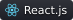
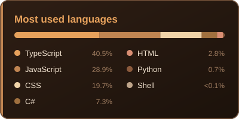

## Tech stack

<!-- Badge tải sẵn về assets/tech/ (nguồn: shields.io) nên README không gọi mạng ra ngoài khi hiển thị.
     Logo đã được nhúng base64 bên trong từng file SVG. Muốn thêm badge: tải file mới vào assets/tech/ rồi thêm .
     Đổi height="22" thành 20/24... nếu muốn badge to nhỏ khác. -->

**Ngôn ngữ lập trình**

  
  
  
  
  
  

**Framework và Runtime**

  
  
  
  

**Cơ sở dữ liệu**

  
  

**Hệ điều hành**

  
  
  

**Hạ tầng và máy chủ**

  
  
  
  

**Công cụ phát triển**

  
  
  

## GitHub stats

<!-- Hàng thống kê: trái là Stats, phải là Top ngôn ngữ.
     Ảnh do scripts/cards.mjs tự vẽ từ GitHub API (xem .github/workflows/profile-cards.yml).
     Không dùng dịch vụ bên ngoài và không dùng action của ai khác: workflow chỉ gọi git + node có sẵn trên runner.
     Hai thẻ cùng kích thước 400x200. Bản tiếng Việt: đổi -en thành -vi. -->

  
  

