

  <a href="README.en.md" title="English">EN</a> · <strong>VI</strong>

  

  
  
  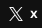
  
  
  <a href="https://github.com/nqchwanq129">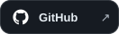</a>
  

### 👋 Giới thiệu

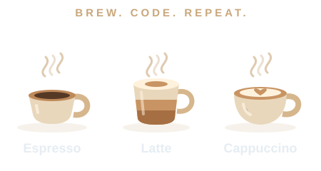

- 👋 Xin chào, mình là Hoàng, một người luôn tò mò đến từ Việt Nam.
- 💻 Mình thích khám phá công nghệ và tạo ra những điều thú vị.
- ☕ Tiếp năng lượng bằng cà phê, sự tò mò và một chút code.
- 🐈 Yêu mèo và trân trọng những điều nhỏ bé trong cuộc sống.
- 🌱 Luôn học hỏi, thử nghiệm và tận hưởng hành trình.

### 🛠️ Công nghệ sử dụng

  
  
  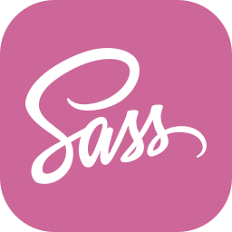
  
  
  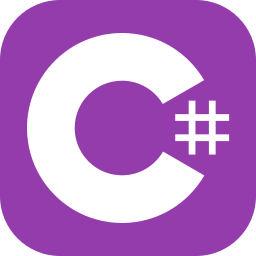
  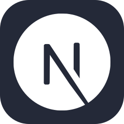
  
  
  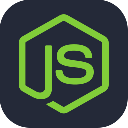
  
  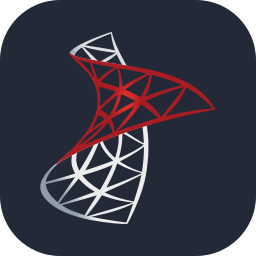
  
  
  
  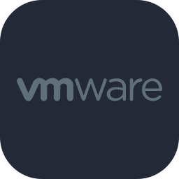
  
  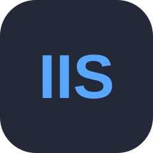
  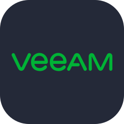
  
  
  

### 🚀 Dự án nổi bật

  <a href="https://github.com/nqchwanq129/nqchwanq129">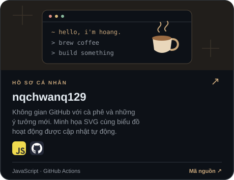</a>
  <a href="https://github.com/nqchwanq129/web-orbcomm-location">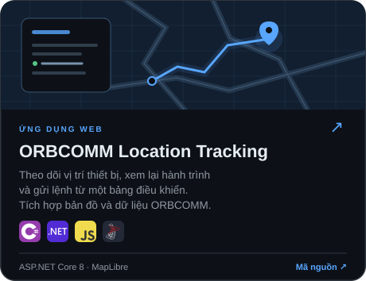</a>

### 📊 Thống kê GitHub

  

### 📈 Hoạt động đóng góp

  

